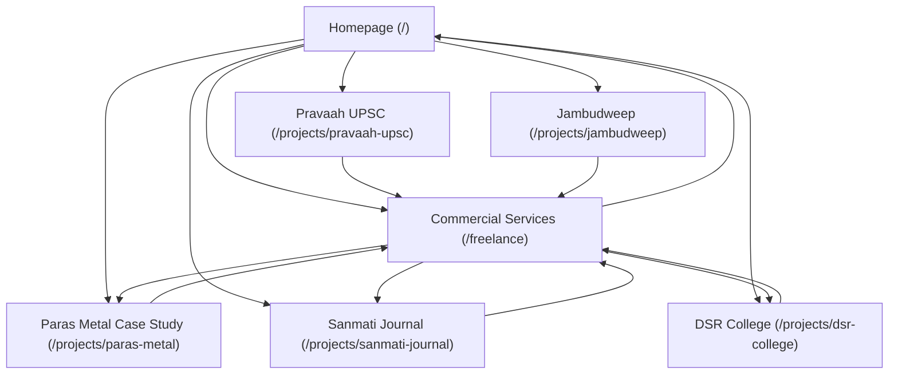

# Keyword Mapping & Search Content Strategy

**Project:** Aradhy Jain Portfolio  
**Target Domain:** `https://aradhy-jain-portfolio.vercel.app/`  
**Philosophy:** In accordance with Google's SEO Starter Guide, keywords are mapped naturally to comprehensive, high-value pages. No thin or doorway pages are created. Content focuses on verified technical deliverables, real business outcomes, and authoritative topical clusters.

---

## 1. Master Keyword Matrix

| Primary Topic Cluster | Target Keyword Phrase | Search Intent | Target Canonical Page | Target Elements (Title / H1 / H2 / Body) | Content Focus & Entity Context |
|:---|:---|:---|:---|:---|:---|
| **Personal Brand** | Aradhy Jain | Navigational / Entity | `/` (Homepage) | Title, H1, Schema `#person`, Hero | Software developer, Web Developer, E-commerce Specialist from India. |
| **Personal Brand** | Aradhy Jain Portfolio | Navigational / Commercial | `/` (Homepage) | Title, Open Graph, Breadcrumb | Engineering case studies, live client projects, verified credentials. |
| **Personal Brand** | Aradhy Jain Developer | Informational / Commercial | `/` (Homepage) | H1, About, Experience | Full-stack engineering, Next.js, Python automation, Data Science background. |
| **Personal Brand** | Aradhy Jain AI Engineer | Informational | `/` & `/projects` | Skills, Projects | Data annotation, machine learning projects (Iris, Botany ML, Sentiment Analysis). |
| **Development** | Web Developer India | Commercial / Trans | `/` (Homepage) | Subheadline, Trust Strip, Schema | Custom responsive website engineering for businesses, SMBs, institutions. |
| **Development** | Next.js Developer India | Commercial / Technical | `/` (Homepage) | Tech stack badges, Hero, Projects | Production Next.js 14, App Router, SSR/SSG, TypeScript, Tailwind CSS. |
| **Development** | Full Stack Developer Portfolio | Informational / Proof | `/` & `/projects` | Projects Header, GitHub links | End-to-end applications: frontend, backend API routes, database schemas. |
| **Development** | Website Development Services | Commercial / High Intent | `/freelance` & `#services` | H1 `/freelance`, Package Cards | Scoped web packages, institutional portals, corporate web presences. |
| **Development** | E-commerce Website Developer | Commercial / Trans | `/freelance` & `/projects/paras-metal` | H2 Commercial Services, Case Study | Storefronts, payment gateways, product catalog architecture, conversion optimization. |
| **AI & Automation** | Generative AI Developer | Commercial / Technical | `/` (Homepage) | Chatbot, AI lead tools | Integrated Gemini/OpenAI API logic, AI client assistants, automated audits. |
| **AI & Automation** | AI Application Developer | Informational / Commercial | `/projects` & `#skills` | Skills Section, Case Studies | Applied AI workflows, natural language processing, intelligent UI widgets. |
| **AI & Automation** | Python Automation Developer | Commercial / Technical | `/freelance` & `#experience` | Services, RIO Internship | Python scripting, data ETL pipelines, automated reporting, web scraping/crawling. |
| **AI & Automation** | AI Engineer Portfolio | Informational | `/projects/social-media-analytics` | Case Study, Data Models | NLP sentiment pipeline, statistical modeling, machine learning benchmarks. |
| **Freelancing** | Freelance Website Developer India | Commercial / High Intent | `/freelance` | Title, H1 `/freelance`, FAQ | Direct freelance partnerships, transparent contracts, zero-markup hosting policy. |
| **Freelancing** | Website Developer for Small Businesses | Commercial / Local | `/freelance` & `#why-work-with-me` | Value Proposition, Pricing | Affordable corporate websites, fast delivery, direct WhatsApp support. |
| **Freelancing** | E-commerce Development Services | Commercial / High Intent | `/freelance` & `/projects/paras-metal` | Commercial Services Pillar 2 | Multi-channel marketplace setup (Amazon, Flipkart, Meesho) + Web store. |
| **Freelancing** | Technical SEO Services | Commercial / Technical | `/freelance` & `#audit-tool` | Client Lead Tools, Audit Section | Core Web Vitals tuning, JSON-LD Schema, robots.txt, XML sitemaps, indexation. |

---

## 2. Page-by-Page Content Architecture

### 1. Homepage (`/`)
* **Primary Title:** `Aradhy Jain | Web Developer, E-commerce & Digital Growth Specialist`
* **Meta Description:** `Portfolio of Aradhy Jain: Web Developer & E-commerce Specialist in India. Engineering high-performance Next.js websites, multi-channel marketplace operations (Amazon, Flipkart, Meesho), technical SEO, and Python automation.`
* **Core Entity Themes:** Professional credibility, live proof points (Paras Metal, Sanmati Journal, DSR College), direct client contact.

### 2. Commercial Freelance Services (`/freelance`)
* **Primary Title:** `Freelance Web Development & Digital Growth Services | Aradhy Jain`
* **Meta Description:** `Hire Aradhy Jain for custom website development, e-commerce storefronts, marketplace catalog optimization (Amazon, Flipkart, Meesho), technical SEO, and automated reporting. Transparent milestones & zero hosting markup.`
* **Core Entity Themes:** Commercial deliverables, clear package deliverables, interactive brief assistant, WhatsApp/Email booking.

### 3. Flagship Project Case Studies (`/projects/[slug]`)
* **Paras Metal (`/projects/paras-metal`):**
  * *Keywords:* E-commerce Website Developer, Marketplace Catalogue Optimization, Amazon Flipkart Listing Support.
  * *Entity:* Artisanal brass handicraft multi-channel retail operations.
* **Sanmati Journal (`/projects/sanmati-journal`):**
  * *Keywords:* Academic Publishing Platform, Research Journal Website, ISSN CrossRef DOI Integration.
  * *Entity:* Peer-reviewed scholarly open-access journal digital infrastructure.
* **Dr. Sarvepalli Radhakrishnan College (`/projects/dsr-college`):**
  * *Keywords:* College Website Developer, Institutional Web Portal, Teacher Education Portal India.
  * *Entity:* Recognized academic teacher training institution in Nalanda, Bihar.
* **Pravaah UPSC (`/projects/pravaah-upsc`):**
  * *Keywords:* Civil Services Examination Preparation Platform, Educational Web Portal, UPSC Resource Dashboard.
  * *Entity:* Structured learning resource portal with syllabus mapping and mentorship channels.
* **Jambudweep Tirth (`/projects/jambudweep`):**
  * *Keywords:* Cultural Heritage Website, Spiritual Center Portal, Hastinapur Tourism Guide.
  * *Entity:* Historical and architectural landmark pilgrim portal.

---

## 3. Natural Internal Linking Hierarchy

* Every case study links back contextually to `/freelance` with descriptive anchor text ("Explore E-commerce Development Services", "Hire Web Developer for Institutional Website").
* The `/freelance` page links directly to verified proof points (`/projects/paras-metal`, `/projects/sanmati-journal`, etc.) as evidence for prospective clients.
